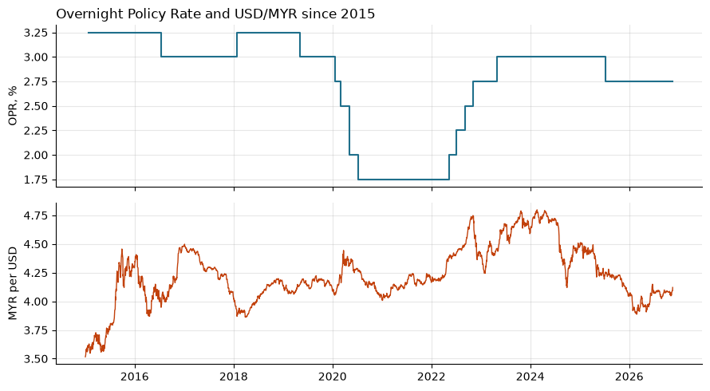

# bursakit

[](https://pypi.org/project/bursakit/)
[](https://pypi.org/project/bursakit/)
[](https://github.com/MaosterM/bursakit/actions/workflows/ci.yml)
[](https://github.com/MaosterM/bursakit/actions/workflows/live.yml)
[](https://github.com/MaosterM/bursakit/blob/main/LICENSE)

Bursa Malaysia stock data and Malaysian macro series as pandas DataFrames.
Cached locally, one schema per data type, more than one source.



<sub>Made with `bk.macro.opr()` and `bk.macro.fx("USD")`. Source: Bank Negara Malaysia
([terms](https://www.bnm.gov.my/terms-of-use-bnm-datasets)); USD/MYR via data.gov.my
([CC BY 4.0](https://creativecommons.org/licenses/by/4.0/)). Code in
[examples/quickstart.ipynb](https://github.com/MaosterM/bursakit/blob/main/examples/quickstart.ipynb).</sub>

Status: alpha. Python 3.10 or later.

```bash
pip install bursakit
```

Not affiliated with Bursa Malaysia, Bank Negara Malaysia or Yahoo. bursakit ships no data:
each user fetches their own, under each source's terms (see Sources below).

## Usage

```python
import bursakit as bk

# Daily prices. 1155, "1155.KL" and "MAYBANK" are the same ticker.
df = bk.prices("MAYBANK", start="2024-01-01", end="2024-12-31")
#               open  high   low  close    volume
# date
# 2024-01-02    8.89  8.92  8.83   8.92   6414300
# 2024-01-03    8.92  8.93  8.88   8.89   8678500

bk.dividends("1155")  # ex-date index, amount per share in MYR
bk.listings()  # code index: name, company, sector, market
bk.resolve("maybank")  # Ticker(code='1155', name='MAYBANK')

bk.macro.opr()  # Overnight Policy Rate decisions, last 5 years
bk.macro.fx("USD")  # MYR per 1 USD: buy, sell, mid, last 12 months
```

The second call for the same data reads from the local cache and makes no request.

```python
bk.prices("1155", start="2020-01-01")  # one request
bk.prices("1155", start="2020-01-01")  # none
bk.prices("1155", start="2020-01-01", refresh=True)  # fetch again, replace what is stored

bk.cache.info()  # location, row counts
bk.cache.clear()  # or bk.cache.clear("prices")
```

Every DataFrame says where it came from:

```python
df.attrs  # {'kind': 'prices', 'ticker': '1155', 'currency': 'MYR',
#  'source': 'yahoo', 'attribution': 'Yahoo Finance',
#  'terms': 'https://legal.yahoo.com/xw/en/yahoo/terms/otos/index.html'}
```

When you publish or share data, show `attribution` and link to `terms`.

### Command line

```bash
bursakit prices 1155 --start 2024-01-01 --csv
bursakit dividends MAYBANK
bursakit listings --csv --out listings.csv
bursakit opr --start 2015-01-01
bursakit fx USD --start 2024-01-01 --csv
bursakit resolve maybank
bursakit cache info
```

## Schemas

Column names and dtypes are the same whichever source answered. Dates are timezone-naive
Malaysian calendar dates, the index is sorted and unique, money is in MYR.

| Function | Index | Columns |
| --- | --- | --- |
| `prices` | `date` | `open`, `high`, `low`, `close` (float64), `volume` (int64) |
| `dividends` | `date` (ex-date) | `amount` (float64, MYR per share) |
| `listings` | `code` (string) | `name`, `company`, `sector`, `market` (string) |
| `macro.opr` | `date` (decision date) | `rate`, `change` (float64, percent) |
| `macro.fx` | `date` | `buy`, `sell`, `mid` (float64, MYR per 1 unit of the currency) |

Known gaps: `market` is empty and `sector` uses Yahoo's sector names. Bursa's own
classification is only available from Bursa, whose terms forbid storing its website content
without written consent. Prices and dividends are adjusted for
splits and bonus issues by the source.

## Errors

```python
from bursakit import TickerNotFound, SourceUnavailable, RateLimited

try:
    bk.prices("NOTAREALCO")
except TickerNotFound as exc:
    print(exc.suggestions)
```

| Error | Meaning |
| --- | --- |
| `TickerNotFound` | No Bursa listing matches. `.suggestions` holds near matches. |
| `SourceUnavailable` | Every source for that data type failed. `.causes` lists each failure. |
| `RateLimited` | A source asked us to slow down. Subclass of `SourceUnavailable`; `.retry_after` in seconds. |

A source that changes the shape of its response is rejected by the schema check and the next
source is tried. Nothing unvalidated is written to the cache.

A price day with a missing price or volume is dropped and the rest of the range is returned.
Each dropped day is logged as a warning on the `bursakit` logger.

## Sources

| Data | Source order | Terms |
| --- | --- | --- |
| prices, dividends, listings, name lookup | Yahoo Finance through `yfinance` | Personal, non-commercial use; no redistribution |
| `macro.opr` | Bank Negara Malaysia Open API | Free, commercial use and redistribution allowed with credit |
| `macro.fx` | data.gov.my Open API, then Bank Negara Malaysia Open API | Same as BNM; data.gov.my is CC BY 4.0 |

**Yahoo data is for your own use.** Yahoo's terms do not allow automated collection, commercial
use or redistribution without Yahoo's written permission, and `yfinance` is unofficial. Do not
publish, sell or serve Yahoo-sourced prices, dividends or listings to others.

BNM and data.gov.my data can be shared and used commercially if you credit it: "Source: Bank
Negara Malaysia" with a link to the BNM dataset terms. `df.attrs` carries both.
See [docs/source-terms.md](https://github.com/MaosterM/bursakit/blob/main/docs/source-terms.md) for the clauses behind this table.

Requests to one source are spaced out. data.gov.my allows 4 requests a minute, so a second
request within 15 seconds waits. A wait of 5 seconds or more is logged as a warning on the
`bursakit` logger; `logging.getLogger("bursakit").setLevel("ERROR")` silences it.
See [docs/spike-go-no-go.md](https://github.com/MaosterM/bursakit/blob/main/docs/spike-go-no-go.md) for what was verified.

## Cache

SQLite file under `%LOCALAPPDATA%\bursakit\Cache` on Windows or `~/.cache/bursakit` elsewhere.
Set `BURSAKIT_CACHE_DIR` to move it.

- Price, FX and OPR rows dated before today are kept permanently. Only the missing tail is fetched.
- Today's rows expire: 15 minutes for prices, 6 hours for FX and OPR.
- Dividends expire after 24 hours, listings after 7 days, name lookups after 30 days.
- Each price refresh overlaps the stored history by a week. If the overlap no longer matches
  (a split or bonus issue), the ticker's history is refetched.
- `refresh=True` replaces what is stored for that ticker or series with the requested range.
  The stored rows are removed only after the new fetch succeeds, so a failed refresh loses nothing.

## Development

```bash
git clone https://github.com/MaosterM/bursakit
cd bursakit
pip install -e ".[dev]"
pytest              # offline, replays recorded responses
ruff check .
mypy
```

Tests block network access. `python tests/record_fixtures.py` re-records the fixtures from
the live sources.

`pytest tests_live` asks the real sources for a little data and checks the answers still fit
the schemas. It needs network access and is not part of plain `pytest`. A GitHub Actions
workflow runs it every night; a failure there means a source changed or is down. A test is
skipped, not failed, when a source rate limits the machine running it.
